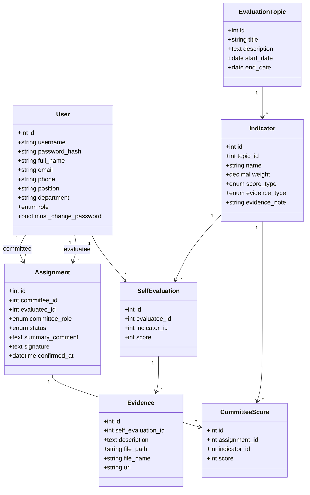

# บทที่ 02: ออกแบบและสร้างฐานข้อมูล

## เป้าหมาย

เรียนจบบทนี้แล้ว นักเรียนจะ
- อ่านโจทย์แล้วแปลงเป็น "ตาราง" ได้
- สร้างฐานข้อมูล 7 ตาราง ที่มีความสัมพันธ์ถูกต้อง ด้วยไฟล์ `schema.sql`
- ใส่ข้อมูลตัวอย่างสำหรับทดสอบ ด้วยไฟล์ `seed.sql`
- อ่าน SQL ออกทีละคำ ว่าคำไหนเป็นคำสั่ง คำไหนตั้งชื่อเอง
- วาด Class Diagram ได้

🏆 ส่วนที่ 2 ทั้งหมด (5 คะแนน): 2.1 มีอย่างน้อย 3 ตาราง, 2.2 มีความสัมพันธ์เหมาะสม, 2.3 ชนิดข้อมูลเหมาะสม, 2.4 Class Diagram, 2.5 ตั้งชื่อสื่อความหมาย

⏱️ ครั้งแรกที่เรียน: ประมาณ **3 ชั่วโมง** | วันแข่ง (เมื่อคล่องแล้ว): **30 นาที** (ออกแบบ 10 นาที, เขียน SQL 20 นาที)

### บทนี้แบ่งเป็นขั้นเล็กๆ

| ภาค | ทำอะไร | จำนวนขั้น |
|---|---|---|
| ภาค ก (2.1-2.3) | ออกแบบบนกระดาษ **ยังไม่เขียนโค้ด** | 5 ขั้น |
| ภาค ข (2.4-2.7) | เขียน SQL ทีละตาราง รันและตรวจผล | 16 ขั้น |

> 💡 **ก่อนเริ่มบทนี้** ต้องทำบท 01 เสร็จ: MySQL ใน Docker รันอยู่ (`docker ps` เห็น `eva_mysql`) และมีโฟลเดอร์ `backend/sql`

---

# ภาค ก: ออกแบบ (ยังไม่เขียนโค้ด)

## 2.1 อ่านโจทย์แล้วหา "ตาราง"

### ขั้นที่ 2.1.1 หาคำนามในโจทย์

> 🎯 **ขั้นนี้จะได้:** รายชื่อตารางที่ต้องสร้าง

📖 **เทคนิค:** หาคำนาม (คน / สิ่งของ / เหตุการณ์) ในโจทย์ คำนามที่ต้องเก็บข้อมูล **หลายรายการ** = ตาราง

ลองอ่านโจทย์แล้วขีดเส้นใต้คำนาม

> งานบุคลากร **เพิ่มหัวข้อการประเมิน** กำหนดช่วงเวลา **เพิ่มตัวชี้วัด** ในแต่ละหัวข้อ
> **เพิ่มผู้รับการประเมิน** และ **กรรมการ** **มอบหมายกรรมการ** ให้ประเมินผู้รับการประเมินแต่ละคน
> ผู้รับการประเมิน **กรอกคะแนนตนเอง** และ **แนบหลักฐาน**
> กรรมการ **ให้คะแนน** **ความเห็นสรุป** และ **ลายเซ็น**

ได้รายการคำนาม แล้วตัดสินใจทีละตัว

| คำนามในโจทย์ | เป็นตารางไหม? | เหตุผล |
|---|---|---|
| ผู้ใช้ (hr, ผู้รับการประเมิน, กรรมการ) | ✅ `users` | มีหลายคน |
| หัวข้อการประเมิน | ✅ `evaluation_topics` | มีหลายหัวข้อ แต่ละหัวข้อมีวันเปิด-ปิด |
| ตัวชี้วัด | ✅ `indicators` | 1 หัวข้อมีหลายตัวชี้วัด |
| การมอบหมายกรรมการ | ✅ `assignments` | จับคู่ "กรรมการ ↔ ผู้รับการประเมิน" มีหลายคู่ |
| คะแนนตนเอง | ✅ `self_evaluations` | ผู้รับการประเมิน 1 คน × ตัวชี้วัด 1 ตัว = 1 คะแนน |
| หลักฐาน | ✅ `evidences` | 1 ตัวชี้วัดแนบได้หลายรายการ |
| คะแนนกรรมการ | ✅ `committee_scores` | กรรมการ 1 คน × ตัวชี้วัด 1 ตัว ต่อผู้รับประเมิน 1 คน |
| ความเห็นสรุป, ลายเซ็น | ❌ เป็นคอลัมน์ใน `assignments` | ดูขั้น 2.1.2 |

> 💡 **กฎตั้งชื่อ (เกณฑ์ 2.5):** ชื่อตารางเป็นภาษาอังกฤษ ตัวเล็ก **พหูพจน์** (เติม s) คั่นคำด้วย `_` เช่น `self_evaluations` ชื่อคอลัมน์ก็ใช้แบบเดียวกัน เช่น `full_name`

### ขั้นที่ 2.1.2 ตัดสินใจ 2 เรื่องที่มักสงสัย

> 🎯 **ขั้นนี้จะได้:** เข้าใจเหตุผลของการออกแบบ (กรรมการชอบถาม)

**เรื่องที่ 1: ทำไมผู้ใช้ 3 บทบาทอยู่ตารางเดียว?**
- ทุกบทบาทมีข้อมูลเหมือนกัน: ชื่อ, รหัสผ่าน, อีเมล, เบอร์โทร
- login ด้วยหน้าเดียวกัน ค้นหาที่ตารางเดียว
- แยกบทบาทด้วยคอลัมน์ `role` ที่มีค่าได้ 3 แบบ: `hr` / `evaluatee` / `committee`

**เรื่องที่ 2: ทำไมความเห็นสรุปและลายเซ็นไม่แยกเป็นตาราง?**
- กรรมการ 1 คน เขียนความเห็น 1 ครั้ง ต่อผู้รับประเมิน 1 คน
- ซึ่งตรงกับ "1 แถวของ assignments" พอดี (1 แถว = กรรมการ 1 คน + ผู้รับประเมิน 1 คน)
- จึงเก็บเป็นคอลัมน์ใน assignments ได้เลย ไม่ต้องสร้างตารางเพิ่ม

## 2.2 ความสัมพันธ์ระหว่างตาราง

### ขั้นที่ 2.2.1 ความสัมพันธ์แบบ 1 ต่อ N และ Foreign Key

> 🎯 **ขั้นนี้จะได้:** เข้าใจว่าตารางเชื่อมกันอย่างไร

📖 ตัวอย่าง: **หัวข้อ 1 หัวข้อ มีตัวชี้วัดได้หลายตัว** เรียกว่าความสัมพันธ์ **1 ต่อ N** (N = หลาย)

```text
evaluation_topics (ฝั่ง 1)              indicators (ฝั่ง N)
┌────┬─────────────────────┐          ┌────┬──────────┬─────────────────────┐
│ id │ title               │          │ id │ topic_id │ name                │
├────┼─────────────────────┤          ├────┼──────────┼─────────────────────┤
│ 1  │ ด้านการจัดการเรียนการสอน │ ◀──────┐ │ 1  │    1     │ การจัดทำแผน...        │
│ 2  │ ด้านคุณลักษณะ...        │ ◀───┐  ├─│ 2  │    1     │ การใช้สื่อ...          │
└────┴─────────────────────┘     │  └─│ 3  │    1     │ การทำวิจัย...          │
                                 └────│ 4  │    2     │ การเข้ารับการอบรม...   │
                                      └────┴──────────┴─────────────────────┘
```

**กฎสำคัญ:** ฝั่ง **N** จะมีคอลัมน์ที่เก็บ id ของฝั่ง **1** เสมอ
- `indicators.topic_id` เก็บ id ของหัวข้อที่ตัวชี้วัดนี้อยู่
- คอลัมน์แบบนี้เรียกว่า **Foreign Key (FK)** = "กุญแจที่ชี้ไปตารางอื่น"
- ส่วน `id` ของแต่ละตาราง เรียกว่า **Primary Key (PK)** = "เลขประจำแถว ห้ามซ้ำ"

### ขั้นที่ 2.2.2 ภาพความสัมพันธ์ทั้งระบบ (ER Diagram)

> 🎯 **ขั้นนี้จะได้:** เห็นภาพว่า 7 ตารางเชื่อมกันอย่างไร

```text
                    ┌──────────────────┐
                    │      users       │
                    │ (hr/evaluatee/   │
                    │   committee)     │
                    └──────────────────┘
                      │1             │1
          ในฐานะกรรมการ│              │ในฐานะผู้รับประเมิน
                      │N             │N
                    ┌──────────────────┐
                    │   assignments    │  ← กรรมการ 1 คน + ผู้รับประเมิน 1 คน
                    │ status, comment, │     + สถานะ ความเห็น ลายเซ็น
                    │ signature        │
                    └──────────────────┘
                             │1
                             │N
┌───────────────────┐  ┌──────────────────┐
│ evaluation_topics │  │ committee_scores │  ← คะแนนที่กรรมการให้แต่ละตัวชี้วัด
└───────────────────┘  └──────────────────┘
         │1                    │N
         │N                    │
┌───────────────────┐          │
│    indicators     │──────────┘1
└───────────────────┘
         │1
         │N
┌───────────────────┐        users (ผู้รับประเมิน) 1 ── N self_evaluations
│ self_evaluations  │  ← คะแนนตนเอง
└───────────────────┘
         │1
         │N
┌───────────────────┐
│     evidences     │  ← หลักฐาน (คำอธิบาย + ไฟล์ หรือ URL)
└───────────────────┘
```

| ความสัมพันธ์ | อ่านว่า | FK อยู่ที่ |
|---|---|---|
| evaluation_topics 1 ── N indicators | หัวข้อ 1 หัวข้อ มีหลายตัวชี้วัด | `indicators.topic_id` |
| users 1 ── N assignments (2 เส้น) | ผู้ใช้ 1 คน เป็นกรรมการได้หลายคู่ และเป็นผู้รับประเมินได้หลายคู่ | `assignments.committee_id`, `assignments.evaluatee_id` |
| users 1 ── N self_evaluations | ผู้รับประเมิน 1 คน มีคะแนนตนเองหลายตัวชี้วัด | `self_evaluations.evaluatee_id` |
| indicators 1 ── N self_evaluations | ตัวชี้วัด 1 ตัว มีคะแนนจากหลายคน | `self_evaluations.indicator_id` |
| self_evaluations 1 ── N evidences | คะแนนตนเอง 1 รายการ แนบหลักฐานได้หลายชิ้น | `evidences.self_evaluation_id` |
| assignments 1 ── N committee_scores | กรรมการ 1 คู่ ให้คะแนนหลายตัวชี้วัด | `committee_scores.assignment_id` |
| indicators 1 ── N committee_scores | ตัวชี้วัด 1 ตัว ได้คะแนนจากกรรมการหลายคน | `committee_scores.indicator_id` |

## 2.3 ชนิดข้อมูล

### ขั้นที่ 2.3.1 เลือกชนิดข้อมูลให้เหมาะ

> 🎯 **ขั้นนี้จะได้:** เลือกชนิดข้อมูลของแต่ละคอลัมน์ได้ (เกณฑ์ 2.3 ตรวจเรื่องนี้)

| ชนิด | ใช้กับ | ตัวอย่างในระบบ |
|---|---|---|
| `INT AUTO_INCREMENT PRIMARY KEY` | เลขประจำแถว MySQL เพิ่มให้เองทีละ 1 | `id` ทุกตาราง |
| `INT` | ตัวเลขจำนวนเต็ม | `topic_id` (FK) |
| `VARCHAR(n)` | ข้อความสั้น ยาวได้ไม่เกิน n ตัว | `username VARCHAR(50)` |
| `TEXT` | ข้อความยาว | `description`, `summary_comment` |
| `MEDIUMTEXT` | ข้อความยาวมาก (ถึง 16MB) | `signature` (รูปลายเซ็นแปลงเป็นข้อความ base64 ยาวหลายหมื่นตัว) |
| `DECIMAL(5,2)` | ทศนิยมแม่นยำ ทั้งหมด 5 หลัก ทศนิยม 2 หลัก (เช่น 100.00) | `weight` น้ำหนักคะแนน (**ห้ามใช้ FLOAT กับคะแนน** เพราะคลาดเคลื่อน) |
| `TINYINT` | ตัวเลขเล็ก (-128 ถึง 127) | `score` (0-4) |
| `BOOLEAN` | จริง/เท็จ (MySQL เก็บเป็น 1/0) | `must_change_password` |
| `DATE` | วันที่อย่างเดียว | `start_date`, `end_date` |
| `DATETIME` | วันที่ + เวลา | `created_at`, `confirmed_at` |
| `ENUM('a','b')` | เลือกได้จากรายการเท่านั้น | `role`, `status`, `score_type` |

> 💡 **ทำไมใช้ ENUM?** ฐานข้อมูลจะไม่ยอมให้ใส่ค่าอื่น เช่น `role` ใส่ `'admin'` ไม่ได้ ช่วยกันข้อมูลผิด
> 💡 **ทำไม username ใช้ VARCHAR(50) ไม่ใช่ TEXT?** ข้อความสั้นที่รู้ความยาวสูงสุด ใช้ VARCHAR ประหยัดกว่า และทำ UNIQUE ได้

---

# ภาค ข: เขียน SQL ทีละขั้น

> 💡 **กติกาเหมือนบทอื่น:** พิมพ์เอง, ดูเลขบรรทัดในกล่องโค้ดคู่กับตาราง 🔍, syntax ที่สอนแล้วจะไม่อธิบายซ้ำ
> SQL **ไม่สนตัวพิมพ์เล็กใหญ่ของคำสั่ง** (`create table` = `CREATE TABLE`) แต่นิยมเขียนคำสั่งเป็นตัวใหญ่ ชื่อตาราง/คอลัมน์เป็นตัวเล็ก จะอ่านแยกง่าย

## 2.4 เขียน schema.sql (โครงสร้างตาราง)

### ขั้นที่ 2.4.1 ส่วนหัวของไฟล์: ภาษาไทย และลบตารางเดิม

> 🎯 **ขั้นนี้จะได้:** ไฟล์ schema.sql ที่รันซ้ำได้กี่ครั้งก็ได้ (ลบของเก่าก่อนสร้างใหม่)

⌨️ **พิมพ์โค้ด:** สร้างไฟล์ใหม่ `backend/sql/schema.sql`

```sql
-- ระบบประเมินบุคลากร: โครงสร้างฐานข้อมูล
-- รันซ้ำได้ (ลบตารางเดิมก่อน) เรียงลำดับลบจากตารางลูกไปตารางแม่
SET NAMES utf8mb4;

DROP TABLE IF EXISTS committee_scores;
DROP TABLE IF EXISTS evidences;
DROP TABLE IF EXISTS self_evaluations;
DROP TABLE IF EXISTS assignments;
DROP TABLE IF EXISTS indicators;
DROP TABLE IF EXISTS evaluation_topics;
DROP TABLE IF EXISTS users;
```

🔍 **อ่านโค้ดทีละบรรทัด**

| บรรทัด | ทำอะไร | เอาไว้ใช้ทำอะไร |
|---|---|---|
| 1-2 | คอมเมนต์ | บอกว่าไฟล์นี้คืออะไร |
| 3 | บอก MySQL ว่าข้อความในไฟล์นี้เป็น utf8mb4 | **ภาษาไทยในไฟล์ไม่เพี้ยน** ถ้าไม่ใส่ อาจเห็น `????` |
| 5-11 | ลบตารางถ้ามีอยู่แล้ว ทีละตาราง | รันไฟล์ซ้ำได้ (ตอนแก้โครงสร้างแล้วอยากสร้างใหม่) ไม่ error ว่า "ตารางมีอยู่แล้ว" |

📖 **ทำไมต้องลบจาก "ตารางลูก" ไป "ตารางแม่"?**
- ตารางลูก = ตารางที่มี FK ชี้ไปหาตารางอื่น เช่น `indicators` ชี้ไป `evaluation_topics`
- ถ้าลบ `evaluation_topics` ก่อน ขณะที่ `indicators` ยังชี้หาอยู่ MySQL จะไม่ยอม
- จึงลบตารางที่ "ชี้หาคนอื่น" ก่อน: committee_scores → … → users (ไม่ชี้หาใคร ลบท้ายสุด)

🧩 **Syntax ใหม่ 1: คอมเมนต์ SQL**

```syntax
[s:--] [v:ข้อความ จนจบบรรทัด]
```

- ต้องมี **ช่องว่าง 1 ช่อง** หลัง `--`

🧩 **Syntax ใหม่ 2: คำสั่ง SQL และ `;`**

```syntax
[k:DROP TABLE IF EXISTS] [n:ชื่อตาราง][s:;]
```

| คำ | ชนิด | หน้าที่ |
|---|---|---|
| `DROP TABLE` | 🔵 คำสั่ง SQL | ลบตาราง (พร้อมข้อมูลทั้งหมด) |
| `IF EXISTS` | 🔵 คำสั่ง SQL | "ถ้ามีอยู่" ถ้าไม่มีก็ข้ามไป ไม่ error |
| `committee_scores` | 🟢 ตั้งเอง | ชื่อตาราง |
| `;` | ⚪ เครื่องหมาย | **จบคำสั่ง** ทุกคำสั่ง SQL ต้องจบด้วย `;` |

> ❗ ลืม `;` ท้ายคำสั่ง = คำสั่งนั้นต่อกับคำสั่งถัดไป ได้ error `You have an error in your SQL syntax`

### ขั้นที่ 2.4.2 ตาราง users

> 🎯 **ขั้นนี้จะได้:** ตารางเก็บผู้ใช้ทั้ง 3 บทบาท

⌨️ **พิมพ์โค้ด:** พิมพ์ต่อท้ายไฟล์ schema.sql (เว้น 1 บรรทัด)

```sql
-- ผู้ใช้ทั้ง 3 บทบาท
CREATE TABLE users (
  id INT AUTO_INCREMENT PRIMARY KEY,
  username VARCHAR(50) NOT NULL UNIQUE,
  password_hash VARCHAR(255) NOT NULL,
  full_name VARCHAR(100) NOT NULL,
  email VARCHAR(100) UNIQUE,
  phone VARCHAR(20),
  position VARCHAR(100),
  department VARCHAR(100),
  role ENUM('hr', 'evaluatee', 'committee') NOT NULL,
  must_change_password BOOLEAN NOT NULL DEFAULT TRUE,
  created_at DATETIME NOT NULL DEFAULT CURRENT_TIMESTAMP,
  updated_at DATETIME NOT NULL DEFAULT CURRENT_TIMESTAMP ON UPDATE CURRENT_TIMESTAMP
);
```

🔍 **อ่านโค้ดทีละบรรทัด**

| บรรทัด | ทำอะไร | เอาไว้ใช้ทำอะไร |
|---|---|---|
| 2 | สร้างตารางชื่อ users | - |
| 3 | `id` เลขประจำแถว เพิ่มเองอัตโนมัติ | ใช้อ้างถึงผู้ใช้จากตารางอื่น และใน URL เช่น `/api/users/5` |
| 4 | `username` ห้ามว่าง ห้ามซ้ำ | ใช้ login ถ้าเพิ่มซ้ำ MySQL ตอบ error `ER_DUP_ENTRY` (บท 03 แปลงเป็น 400) |
| 5 | `password_hash` ห้ามว่าง | **เก็บรหัสที่เข้ารหัสแล้ว ไม่เก็บรหัสจริง** ชื่อคอลัมน์บอกชัดว่าเป็น hash (255 ตัวเผื่อความยาวของ hash) |
| 6 | `full_name` ชื่อ-สกุล ห้ามว่าง | แสดงในทุกหน้าและรายงาน |
| 7 | `email` ห้ามซ้ำ แต่ว่างได้ | ข้อมูลติดต่อ (หลายคนเว้นว่างได้ เพราะค่าว่าง NULL ไม่นับว่าซ้ำกัน) |
| 8-10 | เบอร์โทร ตำแหน่ง แผนก ว่างได้ | ข้อมูลประกอบในหน้าโปรไฟล์และรายงาน |
| 11 | `role` เลือกได้ 3 ค่า ห้ามว่าง | แยกบทบาท ใช้ตรวจสิทธิ์ทุก API (บท 04) |
| 12 | `must_change_password` ค่าเริ่มต้น TRUE | ผู้ใช้ใหม่ต้องเปลี่ยนรหัสตอนเข้าครั้งแรก (เกณฑ์ 5.2.1) |
| 13 | `created_at` เวลาที่สร้าง ใส่ให้เองอัตโนมัติ | ประวัติข้อมูล |
| 14 | `updated_at` เวลาที่แก้ล่าสุด อัปเดตเองทุกครั้งที่แก้แถว | ประวัติข้อมูล |
| 15 | ปิดวงเล็บและจบคำสั่ง | - |

🧩 **Syntax ใหม่ 1: CREATE TABLE**

```syntax
[k:CREATE TABLE] [n:ชื่อตาราง] [s:(]
  [n:ชื่อคอลัมน์] [p:ชนิดข้อมูล] [k:ข้อกำหนด][s:,]
  [n:ชื่อคอลัมน์] [p:ชนิดข้อมูล] [k:ข้อกำหนด][s:,]
  [n:ชื่อคอลัมน์สุดท้าย] [p:ชนิดข้อมูล]
[s:);]
```

เทียบกับบรรทัด 4

```syntax
  [n:username] [p:VARCHAR(50)] [k:NOT NULL] [k:UNIQUE][s:,]
```

| คำ | ชนิด | หน้าที่ |
|---|---|---|
| `username` | 🟢 ตั้งเอง | ชื่อคอลัมน์ |
| `VARCHAR(50)` | 🟣 MySQL กำหนด | ชนิดข้อมูล (ขั้น 2.3.1) |
| `NOT NULL` | 🔵 ข้อกำหนด | ห้ามว่าง |
| `UNIQUE` | 🔵 ข้อกำหนด | ห้ามซ้ำกับแถวอื่น |
| `,` | ⚪ เครื่องหมาย | คั่นคอลัมน์ |

กฎที่ต้องจำ
- 1 คอลัมน์ต่อ 1 บรรทัด คั่นด้วย `,`
- **บรรทัดสุดท้ายก่อน `)` ห้ามมี `,`** (ผิดบ่อยที่สุด)
- ปิดด้วย `);` เสมอ

🧩 **Syntax ใหม่ 2: ข้อกำหนดของคอลัมน์**

| ข้อกำหนด | แปลว่า |
|---|---|
| `PRIMARY KEY` | เลขประจำแถว ห้ามซ้ำ ห้ามว่าง (1 ตารางมี 1 ตัว) |
| `AUTO_INCREMENT` | MySQL เติมเลขให้เอง 1, 2, 3, … |
| `NOT NULL` | ห้ามว่าง (ถ้าไม่เขียน = ว่างได้) |
| `UNIQUE` | ห้ามซ้ำ |
| `DEFAULT ค่า` | ถ้าตอนเพิ่มไม่ได้ส่งค่ามา ใช้ค่านี้ |
| `CURRENT_TIMESTAMP` | วันเวลาปัจจุบัน |
| `ON UPDATE CURRENT_TIMESTAMP` | ทุกครั้งที่แก้แถว อัปเดตเป็นเวลาปัจจุบัน |

🧩 **Syntax ใหม่ 3: ENUM และข้อความใน SQL**

```syntax
[n:role] [p:ENUM][s:(][v:'hr'][s:,] [v:'evaluatee'][s:,] [v:'committee'][s:)]
```

- ข้อความใน SQL ใช้ **เครื่องหมาย `' '`** (ฝนทองเดี่ยว)
- ค่าใน ENUM คั่นด้วย `,`

### ขั้นที่ 2.4.3 ตาราง evaluation_topics

> 🎯 **ขั้นนี้จะได้:** ตารางหัวข้อการประเมิน พร้อมช่วงวันเปิด-ปิด

⌨️ **พิมพ์โค้ด:** พิมพ์ต่อท้าย schema.sql

```sql
-- หัวข้อการประเมิน พร้อมช่วงเปิด-ปิด
CREATE TABLE evaluation_topics (
  id INT AUTO_INCREMENT PRIMARY KEY,
  title VARCHAR(200) NOT NULL,
  description TEXT,
  start_date DATE NOT NULL,
  end_date DATE NOT NULL,
  created_at DATETIME NOT NULL DEFAULT CURRENT_TIMESTAMP,
  CHECK (end_date >= start_date)
);
```

🔍 **อ่านโค้ดทีละบรรทัด**

| บรรทัด | ทำอะไร | เอาไว้ใช้ทำอะไร |
|---|---|---|
| 4 | `title` ชื่อหัวข้อ ห้ามว่าง | แสดงในทุกหน้า เช่น "ด้านการจัดการเรียนการสอน" |
| 5 | `description` คำอธิบาย ว่างได้ | รายละเอียดเพิ่มเติม |
| 6-7 | วันเปิด และวันปิด ห้ามว่าง | ระบบตรวจว่าวันนี้อยู่ในช่วงไหม ถ้าไม่อยู่ ห้ามกรอกคะแนน (เกณฑ์ 5.1.2) |
| 9 | ตรวจว่าวันปิดต้องไม่ก่อนวันเปิด | **ด่านสุดท้าย** ถ้าโค้ดลืมตรวจ ฐานข้อมูลก็ไม่ยอม (บท 03 แปลง error นี้เป็น 400) |

🧩 **Syntax ใหม่: CHECK (เงื่อนไขของตาราง)**

```syntax
  [k:CHECK] [s:(][n:คอลัมน์] [s:>=] [n:คอลัมน์หรือค่า][s:)]
```

- เขียนเป็นบรรทัดของตัวเองต่อจากคอลัมน์ทั้งหมด (คั่นด้วย `,` เหมือนคอลัมน์)
- ใช้เครื่องหมายเปรียบเทียบได้: `=` `>` `<` `>=` `<=` `BETWEEN … AND …`
- ถ้าเพิ่ม/แก้ข้อมูลแล้วผิดเงื่อนไข MySQL ตอบ error `ER_CHECK_CONSTRAINT_VIOLATED`

### ขั้นที่ 2.4.4 ตาราง indicators (Foreign Key ตัวแรก)

> 🎯 **ขั้นนี้จะได้:** ตารางตัวชี้วัด ที่ผูกกับหัวข้อ

⌨️ **พิมพ์โค้ด:** พิมพ์ต่อท้าย schema.sql

```sql
-- ตัวชี้วัดในแต่ละหัวข้อ
-- score_type: yes_no = มี/ไม่มี (0/1), scale_4 = สเกล 1-4
-- evidence_type: หลักฐานที่ต้องแนบ none / file (pdf, รูป) / url / any (ไฟล์หรือ url)
CREATE TABLE indicators (
  id INT AUTO_INCREMENT PRIMARY KEY,
  topic_id INT NOT NULL,
  name VARCHAR(200) NOT NULL,
  description TEXT,
  weight DECIMAL(5,2) NOT NULL,
  score_type ENUM('yes_no', 'scale_4') NOT NULL,
  evidence_type ENUM('none', 'file', 'url', 'any') NOT NULL DEFAULT 'any',
  evidence_note VARCHAR(255),
  created_at DATETIME NOT NULL DEFAULT CURRENT_TIMESTAMP,
  CHECK (weight > 0),
  FOREIGN KEY (topic_id) REFERENCES evaluation_topics(id) ON DELETE CASCADE
);
```

🔍 **อ่านโค้ดทีละบรรทัด**

| บรรทัด | ทำอะไร | เอาไว้ใช้ทำอะไร |
|---|---|---|
| 6 | `topic_id` id ของหัวข้อที่ตัวชี้วัดนี้อยู่ | เชื่อมกับหัวข้อ (เป็น FK ดูบรรทัด 15) |
| 7-8 | ชื่อและคำอธิบายตัวชี้วัด | แสดงในหน้าประเมิน |
| 9 | `weight` น้ำหนักคะแนน เช่น 20.00 | ใช้คำนวณคะแนนรวม (บท 06) |
| 10 | `score_type` รูปแบบการให้คะแนน | `yes_no` = มี/ไม่มี (1/0), `scale_4` = ระดับ 1-4 (เกณฑ์ 5.1.4) |
| 11 | `evidence_type` ต้องแนบหลักฐานแบบไหน ค่าเริ่มต้น `any` | `none` ไม่ต้องแนบ / `file` ต้องแนบไฟล์ / `url` ต้องใส่ลิงก์ / `any` อย่างใดก็ได้ |
| 12 | `evidence_note` คำแนะนำว่าควรแนบอะไร | แสดงให้ผู้รับประเมินอ่าน เช่น "ไฟล์ PDF แผนการสอน" |
| 14 | น้ำหนักต้องมากกว่า 0 | กันน้ำหนักติดลบหรือ 0 |
| 15 | `topic_id` ต้องเป็น id ที่มีอยู่จริงในตารางหัวข้อ และถ้าลบหัวข้อ ให้ลบตัวชี้วัดตาม | กันตัวชี้วัดลอยไม่มีหัวข้อ, ไม่ต้องเขียนโค้ดลบตัวชี้วัดเอง (บท 03 ขั้น 3.10.8) |

🧩 **Syntax ใหม่: FOREIGN KEY**

```syntax
  [k:FOREIGN KEY] [s:(][n:คอลัมน์ในตารางนี้][s:)] [k:REFERENCES] [n:ตารางแม่][s:(][n:id][s:)] [k:ON DELETE CASCADE]
```

| คำ | ชนิด | หน้าที่ |
|---|---|---|
| `FOREIGN KEY (topic_id)` | 🔵 + 🟢 | คอลัมน์ topic_id เป็น FK |
| `REFERENCES evaluation_topics(id)` | 🔵 + 🟢 | ชี้ไปที่คอลัมน์ id ของตาราง evaluation_topics |
| `ON DELETE CASCADE` | 🔵 | "ถ้าแถวในตารางแม่ถูกลบ ลบแถวลูกตามด้วย" |

กฎที่ต้องจำ
- **ตารางแม่ต้องสร้างก่อน** (evaluation_topics ต้องอยู่เหนือ indicators ในไฟล์)
- ชนิดข้อมูลของ FK ต้องตรงกับ PK ที่ชี้ไป (`INT` คู่กับ `INT`)
- ถ้าเพิ่มตัวชี้วัดโดยใส่ `topic_id` ที่ไม่มีอยู่จริง MySQL ตอบ error `ER_NO_REFERENCED_ROW_2`

### ขั้นที่ 2.4.5 ตาราง assignments (หัวใจของระบบ)

> 🎯 **ขั้นนี้จะได้:** ตารางจับคู่กรรมการกับผู้รับประเมิน พร้อมผลสรุปของกรรมการ

⌨️ **พิมพ์โค้ด:** พิมพ์ต่อท้าย schema.sql

```sql
-- มอบหมายกรรมการให้ผู้รับประเมิน (1 แถว = กรรมการ 1 คน ต่อผู้รับประเมิน 1 คน)
-- เก็บผลสรุปของกรรมการไว้ที่นี่ด้วย: สถานะ ความเห็นสรุป ลายเซ็น
-- status: pending = ยังไม่ประเมิน, draft = บันทึกร่าง, confirmed = ยืนยันแล้ว (แก้ไม่ได้)
CREATE TABLE assignments (
  id INT AUTO_INCREMENT PRIMARY KEY,
  committee_id INT NOT NULL,
  evaluatee_id INT NOT NULL,
  committee_role ENUM('chair', 'member') NOT NULL DEFAULT 'member',
  status ENUM('pending', 'draft', 'confirmed') NOT NULL DEFAULT 'pending',
  summary_comment TEXT,
  signature MEDIUMTEXT,
  confirmed_at DATETIME,
  created_at DATETIME NOT NULL DEFAULT CURRENT_TIMESTAMP,
  UNIQUE (committee_id, evaluatee_id),
  FOREIGN KEY (committee_id) REFERENCES users(id) ON DELETE CASCADE,
  FOREIGN KEY (evaluatee_id) REFERENCES users(id) ON DELETE CASCADE
);
```

🔍 **อ่านโค้ดทีละบรรทัด**

| บรรทัด | ทำอะไร | เอาไว้ใช้ทำอะไร |
|---|---|---|
| 6 | `committee_id` id ของกรรมการ | กรรมการเห็นรายชื่อคนที่ตัวเองต้องประเมิน |
| 7 | `evaluatee_id` id ของผู้รับประเมิน | ผู้รับประเมินเห็นว่าใครเป็นกรรมการของตัวเอง |
| 8 | `committee_role` ประธาน (`chair`) หรือกรรมการร่วม (`member`) | hr กำหนดบทบาทกรรมการ (เกณฑ์ 5.1.9) |
| 9 | `status` สถานะการประเมิน เริ่มต้น `pending` | ติดตามความคืบหน้า (เกณฑ์ 5.1.11): ยังไม่ประเมิน → บันทึกร่าง → ยืนยันแล้ว |
| 10 | `summary_comment` ความเห็นสรุปของกรรมการ | แสดงในรายงานผล |
| 11 | `signature` รูปลายเซ็น (ข้อความ base64) | แสดงในรายงานผล (เกณฑ์ 5.3.7) |
| 12 | `confirmed_at` เวลาที่กดยืนยัน | ว่างได้ จนกว่าจะยืนยัน |
| 14 | คู่ (กรรมการ, ผู้รับประเมิน) ห้ามซ้ำ | กันมอบหมายกรรมการคนเดิมให้คนเดิม 2 ครั้ง |
| 15-16 | FK 2 ตัว ชี้ไปตาราง users ทั้งคู่ | ตารางเดียวกันอ้างได้หลายครั้ง ลบผู้ใช้แล้วการมอบหมายของเขาถูกลบตาม |

🧩 **Syntax ใหม่: UNIQUE หลายคอลัมน์**

```syntax
  [k:UNIQUE] [s:(][n:คอลัมน์1][s:,] [n:คอลัมน์2][s:)]
```

- ต่างจาก `UNIQUE` หลังคอลัมน์เดียว (ขั้น 2.4.2): แบบนี้ห้ามซ้ำ **ทั้งคู่พร้อมกัน**
- กรรมการ 2 ประเมินครู 5 ได้ และกรรมการ 2 ประเมินครู 6 ได้ แต่กรรมการ 2 ประเมินครู 5 **ซ้ำอีกแถว** ไม่ได้

### ขั้นที่ 2.4.6 ตาราง self_evaluations

> 🎯 **ขั้นนี้จะได้:** ตารางเก็บคะแนนที่ผู้รับประเมินให้ตัวเอง

⌨️ **พิมพ์โค้ด:** พิมพ์ต่อท้าย schema.sql

```sql
-- คะแนนประเมินตนเอง (ผู้รับประเมิน 1 คน ต่อตัวชี้วัด 1 ตัว = 1 แถว)
CREATE TABLE self_evaluations (
  id INT AUTO_INCREMENT PRIMARY KEY,
  evaluatee_id INT NOT NULL,
  indicator_id INT NOT NULL,
  score TINYINT,
  updated_at DATETIME NOT NULL DEFAULT CURRENT_TIMESTAMP ON UPDATE CURRENT_TIMESTAMP,
  UNIQUE (evaluatee_id, indicator_id),
  CHECK (score BETWEEN 0 AND 4),
  FOREIGN KEY (evaluatee_id) REFERENCES users(id) ON DELETE CASCADE,
  FOREIGN KEY (indicator_id) REFERENCES indicators(id) ON DELETE CASCADE
);
```

🔍 **อ่านโค้ดทีละบรรทัด**

| บรรทัด | ทำอะไร | เอาไว้ใช้ทำอะไร |
|---|---|---|
| 4-5 | ใคร (ผู้รับประเมิน) ให้คะแนนตัวชี้วัดไหน | ผูกคะแนนกับคนและตัวชี้วัด |
| 6 | `score` คะแนน **ว่างได้** (ไม่มี NOT NULL) | ผู้รับประเมินอาจแนบหลักฐานก่อน แล้วค่อยกรอกคะแนนทีหลัง |
| 8 | 1 คน ต่อ 1 ตัวชี้วัด มีได้แถวเดียว | กรอกซ้ำ = แก้คะแนนเดิม ไม่ใช่เพิ่มแถวใหม่ (บท 06 ใช้ `ON DUPLICATE KEY UPDATE`) |
| 9 | คะแนนอยู่ระหว่าง 0-4 | ครอบคลุมทั้ง yes_no (0/1) และ scale_4 (1-4) |

> 🧩 syntax ใหม่ในขั้นนี้มีแค่ `BETWEEN 0 AND 4` = "อยู่ระหว่าง 0 ถึง 4 (รวม 0 และ 4)" ที่เหลือสอนไปแล้ว

### ขั้นที่ 2.4.7 ตาราง evidences

> 🎯 **ขั้นนี้จะได้:** ตารางเก็บหลักฐานที่แนบกับคะแนนตนเอง

⌨️ **พิมพ์โค้ด:** พิมพ์ต่อท้าย schema.sql

```sql
-- รายละเอียดประกอบ/หลักฐาน (หลายรายการต่อการประเมินตนเอง 1 แถว)
-- แต่ละรายการมีคำอธิบาย และแนบไฟล์หรือ url ได้
CREATE TABLE evidences (
  id INT AUTO_INCREMENT PRIMARY KEY,
  self_evaluation_id INT NOT NULL,
  description TEXT NOT NULL,
  file_path VARCHAR(255),
  file_name VARCHAR(255),
  url VARCHAR(500),
  created_at DATETIME NOT NULL DEFAULT CURRENT_TIMESTAMP,
  FOREIGN KEY (self_evaluation_id) REFERENCES self_evaluations(id) ON DELETE CASCADE
);
```

🔍 **อ่านโค้ดทีละบรรทัด**

| บรรทัด | ทำอะไร | เอาไว้ใช้ทำอะไร |
|---|---|---|
| 5 | หลักฐานนี้เป็นของคะแนนตนเองแถวไหน | ผูกกับ self_evaluations |
| 6 | คำอธิบาย ห้ามว่าง | ผู้รับประเมินอธิบายว่าหลักฐานคืออะไร (เกณฑ์ 5.2.3) |
| 7 | `file_path` ชื่อไฟล์ที่บันทึกจริงบน server (สุ่มชื่อ เช่น `1762500000000-a1b2c3.pdf`) | กันชื่อไฟล์ซ้ำ และกันชื่อไฟล์แปลกๆ (บท 06) |
| 8 | `file_name` ชื่อเดิมที่ผู้ใช้อัปโหลด (เช่น `แผนการสอน.pdf`) | ตอนดาวน์โหลดให้ได้ชื่อเดิม |
| 9 | `url` ลิงก์ (ยาวได้ 500 ตัว) | หลักฐานแบบลิงก์ เช่น Google Drive, YouTube |

### ขั้นที่ 2.4.8 ตาราง committee_scores

> 🎯 **ขั้นนี้จะได้:** ตารางเก็บคะแนนที่กรรมการให้ ครบ 7 ตาราง

⌨️ **พิมพ์โค้ด:** พิมพ์ต่อท้าย schema.sql (ตารางสุดท้าย)

```sql
-- คะแนนที่กรรมการให้ในแต่ละตัวชี้วัด
CREATE TABLE committee_scores (
  id INT AUTO_INCREMENT PRIMARY KEY,
  assignment_id INT NOT NULL,
  indicator_id INT NOT NULL,
  score TINYINT NOT NULL,
  updated_at DATETIME NOT NULL DEFAULT CURRENT_TIMESTAMP ON UPDATE CURRENT_TIMESTAMP,
  UNIQUE (assignment_id, indicator_id),
  CHECK (score BETWEEN 0 AND 4),
  FOREIGN KEY (assignment_id) REFERENCES assignments(id) ON DELETE CASCADE,
  FOREIGN KEY (indicator_id) REFERENCES indicators(id) ON DELETE CASCADE
);
```

🔍 **อ่านโค้ดทีละบรรทัด**

| บรรทัด | ทำอะไร | เอาไว้ใช้ทำอะไร |
|---|---|---|
| 4 | `assignment_id` คู่กรรมการ-ผู้รับประเมินคู่ไหน | 1 assignment บอกได้ทั้ง "กรรมการคนไหน" และ "ประเมินใคร" จึงไม่ต้องเก็บ committee_id + evaluatee_id ซ้ำ |
| 5 | ตัวชี้วัดไหน | - |
| 6 | คะแนน **ห้ามว่าง** | ต่างจาก self_evaluations: กรรมการบันทึกเมื่อให้คะแนนแล้วเท่านั้น |
| 8 | 1 คู่ ต่อ 1 ตัวชี้วัด มีได้แถวเดียว | ให้คะแนนซ้ำ = แก้คะแนนเดิม |

✅ **ลองเลย:** schema.sql ครบ 7 ตารางแล้ว จะรันจริงในขั้น 2.6.1 ตรวจไฟล์ก่อนว่า
- ทุกคำสั่งจบด้วย `);`
- บรรทัดสุดท้ายก่อน `)` ไม่มี `,`
- ลำดับ CREATE: users → evaluation_topics → indicators → assignments → self_evaluations → evidences → committee_scores (แม่ก่อนลูก)

<details>
<summary>📄 ไฟล์ schema.sql ทั้งไฟล์อยู่ที่ไหน</summary>

ไฟล์เฉลย: [backend/sql/schema.sql](../../backend/sql/schema.sql) เปิดเทียบได้ ทุกส่วนที่พิมพ์ในขั้น 2.4.1-2.4.8 ต่อกันตามลำดับ = ไฟล์นี้

</details>

## 2.5 เขียน seed.sql (ข้อมูลตัวอย่าง)

### ขั้นที่ 2.5.1 รหัสผ่านต้องเก็บเป็น hash

> 🎯 **ขั้นนี้จะได้:** เข้าใจว่าทำไมใน seed ไม่มีรหัส `123456` ตรงๆ

📖 **ทำไมต้อง hash?**
ถ้าเก็บรหัส `123456` ตรงๆ ใครเปิดฐานข้อมูลได้ก็เห็นรหัสทุกคน
**hash** คือการแปลงรหัสเป็นข้อความยาวที่ **ย้อนกลับไม่ได้**

```text
123456  ──scrypt + salt──▶  7a598e83...:7b99abc1...
```

- ตอน login เราไม่ได้ "ถอด" hash แต่เอารหัสที่ผู้ใช้พิมพ์มา hash ด้วยวิธีเดิม แล้วเทียบว่าตรงกันไหม
- **salt** = ข้อความสุ่มที่ผสมก่อน hash ทำให้รหัสเดียวกัน ได้ hash ไม่เหมือนกัน
- โจทย์ห้ามใช้ bcrypt ให้ใช้ `crypto.scrypt` ที่มากับ Node.js (เขียนฟังก์ชันนี้ในบท 04 ขั้น 4.2)

ในบทนี้เราใช้ **hash ของรหัส `123456` ที่เตรียมไว้แล้ว** (สร้างด้วยฟังก์ชันในบท 04) **คัดลอกไปใช้ได้เลย** ไม่ต้องพิมพ์เอง

```text
7a598e831d2b0a43997106229036312b:7b99abc140ad74327135f9d0478b5319cb966d37f015005bd9bdac3b7e0fcd99d6bdc9ec7c3c2e894924fc320198660505f641fe7f44ff5eff8ef5269d923075
```

| ส่วน | คืออะไร |
|---|---|
| ก่อน `:` (32 ตัว) | salt |
| หลัง `:` (128 ตัว) | hash ของ `123456` ผสม salt |

### ขั้นที่ 2.5.2 เพิ่มผู้ใช้ 9 คน

> 🎯 **ขั้นนี้จะได้:** บัญชีทดสอบครบ 3 บทบาท (hr 1, กรรมการ 3, ผู้รับประเมิน 5)

⌨️ **พิมพ์โค้ด:** สร้างไฟล์ใหม่ `backend/sql/seed.sql` (บรรทัด 4 วาง hash จากขั้น 2.5.1)

```sql
-- ข้อมูลตัวอย่าง (รันหลัง schema.sql)
-- รหัสผ่านทุกบัญชีคือ 123456 (hash ด้วย crypto.scrypt จาก utils/password.js)
SET NAMES utf8mb4;
SET @pw = '7a598e831d2b0a43997106229036312b:7b99abc140ad74327135f9d0478b5319cb966d37f015005bd9bdac3b7e0fcd99d6bdc9ec7c3c2e894924fc320198660505f641fe7f44ff5eff8ef5269d923075';

-- hr 1, กรรมการ 3, ผู้รับประเมิน 5 (hr ไม่ต้องเปลี่ยนรหัสผ่าน คนอื่นต้องเปลี่ยนตอนเข้าครั้งแรก)
INSERT INTO users (id, username, password_hash, full_name, email, phone, position, department, role, must_change_password) VALUES
(1, 'hr',     @pw, 'สมศรี ใจดี',     'hr@school.ac.th',     '0810000001', 'เจ้าหน้าที่งานบุคลากร', 'งานบุคลากร',       'hr',        FALSE),
(2, 'comm1',  @pw, 'ประเสริฐ วงศ์ดี', 'comm1@school.ac.th',  '0810000002', 'รองผู้อำนวยการ',       'ฝ่ายวิชาการ',      'committee', TRUE),
(3, 'comm2',  @pw, 'วิไล สายทอง',    'comm2@school.ac.th',  '0810000003', 'หัวหน้าแผนก',          'แผนกเทคโนโลยีสารสนเทศ', 'committee', TRUE),
(4, 'comm3',  @pw, 'ชัยวัฒน์ แก้วมา', 'comm3@school.ac.th',  '0810000004', 'ครูชำนาญการพิเศษ',     'แผนกคอมพิวเตอร์ธุรกิจ', 'committee', TRUE),
(5, 'teach1', @pw, 'สมชาย รักเรียน',  'teach1@school.ac.th', '0810000005', 'ครู',                  'แผนกเทคโนโลยีสารสนเทศ', 'evaluatee', TRUE),
(6, 'teach2', @pw, 'มาลี ศรีสุข',     'teach2@school.ac.th', '0810000006', 'ครู',                  'แผนกเทคโนโลยีสารสนเทศ', 'evaluatee', TRUE),
(7, 'teach3', @pw, 'อนันต์ มั่นคง',   'teach3@school.ac.th', '0810000007', 'ครูผู้ช่วย',            'แผนกคอมพิวเตอร์ธุรกิจ', 'evaluatee', TRUE),
(8, 'teach4', @pw, 'กมลา ทองดี',     'teach4@school.ac.th', '0810000008', 'ครู',                  'แผนกการบัญชี',      'evaluatee', TRUE),
(9, 'teach5', @pw, 'ธนพล บุญมี',     'teach5@school.ac.th', '0810000009', 'ครูผู้ช่วย',            'แผนกการตลาด',       'evaluatee', TRUE);
```

🔍 **อ่านโค้ดทีละบรรทัด**

| บรรทัด | ทำอะไร | เอาไว้ใช้ทำอะไร |
|---|---|---|
| 1-2 | คอมเมนต์ | บอกรหัสผ่านของทุกบัญชี (คนทดสอบจะได้รู้) |
| 3 | ข้อความเป็น utf8mb4 | ชื่อภาษาไทยไม่เพี้ยน |
| 4 | สร้างตัวแปร `@pw` เก็บ hash | ใช้ซ้ำทั้ง 9 แถว ไม่ต้องวาง hash ยาวๆ 9 ครั้ง |
| 7 | เพิ่มข้อมูลลงตาราง users โดยบอกชื่อคอลัมน์ 10 ตัว | ลำดับค่าในวงเล็บข้างล่าง ต้องตรงกับลำดับคอลัมน์นี้ |
| 8 | hr: `must_change_password` = FALSE | hr login แล้วใช้ได้เลย ไม่ถูกบังคับเปลี่ยนรหัส (สะดวกตอนทดสอบ) |
| 9-11 | กรรมการ 3 คน | ทดสอบหน้าจอกรรมการ (บท 10) |
| 12-16 | ผู้รับประเมิน 5 คน | ทดสอบหน้าจอผู้รับประเมิน (บท 09) |
| 16 | แถวสุดท้ายจบด้วย `;` | แถวอื่นจบด้วย `,` |

🧩 **Syntax ใหม่ 1: INSERT หลายแถว**

```syntax
[k:INSERT INTO] [n:ชื่อตาราง] [s:(][n:คอลัมน์1][s:,] [n:คอลัมน์2][s:)] [k:VALUES]
[s:(][v:ค่า1][s:,] [v:ค่า2][s:)][s:,]
[s:(][v:ค่า1][s:,] [v:ค่า2][s:)][s:;]
```

กฎที่ต้องจำ
- จำนวนค่าในแต่ละวงเล็บ = จำนวนคอลัมน์ และ **เรียงลำดับตรงกัน**
- ข้อความใส่ `' '`, ตัวเลขไม่ต้องใส่, `TRUE`/`FALSE`/`NULL` ไม่ต้องใส่
- คั่นแต่ละแถวด้วย `,` แถวสุดท้ายจบด้วย `;`
- คอลัมน์ที่ไม่ได้ระบุ (เช่น `created_at`) จะได้ค่า `DEFAULT`

> 💡 **ทำไมใส่ `id` เอง ทั้งที่มี AUTO_INCREMENT?** เพื่อให้ตารางอื่นใน seed อ้างถึงได้แน่นอน เช่น "ผู้ใช้ id 5 = teach1" (ตอนใช้งานจริงผ่าน API ไม่ต้องใส่ id)

🧩 **Syntax ใหม่ 2: ตัวแปรของ MySQL**

```syntax
[k:SET] [n:@ชื่อตัวแปร] [s:=] [v:'ค่า'][s:;]
```

- ตัวแปรขึ้นต้นด้วย `@` ใช้ได้จนจบการเชื่อมต่อ
- เรียกใช้ด้วยชื่อ `@pw` ได้ทุกที่ที่ใส่ค่าได้

### ขั้นที่ 2.5.3 เพิ่มหัวข้อ 2 หัวข้อ และตัวชี้วัด 6 ตัว

> 🎯 **ขั้นนี้จะได้:** ข้อมูลหัวข้อและตัวชี้วัด ครบทั้ง 2 รูปแบบคะแนน และหลักฐานทั้ง 4 แบบ

⌨️ **พิมพ์โค้ด:** พิมพ์ต่อท้าย seed.sql

```sql
-- 2 หัวข้อ
INSERT INTO evaluation_topics (id, title, description, start_date, end_date) VALUES
(1, 'ด้านการจัดการเรียนการสอน', 'ประเมินการวางแผนและการจัดการเรียนรู้', '2026-11-01', '2026-12-31'),
(2, 'ด้านคุณลักษณะและการพัฒนาตนเอง', 'ประเมินวินัย การพัฒนาตนเอง และการมีส่วนร่วม', '2026-11-01', '2026-12-31');

-- ตัวชี้วัดทั้งสองแบบ (น้ำหนักรวม 100)
INSERT INTO indicators (id, topic_id, name, description, weight, score_type, evidence_type, evidence_note) VALUES
(1, 1, 'การจัดทำแผนการจัดการเรียนรู้', 'มีแผนการจัดการเรียนรู้ครบทุกรายวิชาที่สอน', 20, 'scale_4', 'file', 'ไฟล์ PDF แผนการจัดการเรียนรู้'),
(2, 1, 'การใช้สื่อและเทคโนโลยีในการสอน', 'ใช้สื่อดิจิทัลหรือแพลตฟอร์มออนไลน์ประกอบการสอน', 15, 'scale_4', 'any', 'ภาพกิจกรรม หรือ URL สื่อการสอน'),
(3, 1, 'การทำวิจัยในชั้นเรียน', 'มีงานวิจัยในชั้นเรียนอย่างน้อย 1 เรื่องต่อปีการศึกษา', 15, 'yes_no', 'file', 'ไฟล์ PDF รายงานวิจัย'),
(4, 2, 'การเข้ารับการอบรมพัฒนาตนเอง', 'เข้ารับการอบรมอย่างน้อย 20 ชั่วโมงต่อปี', 10, 'yes_no', 'any', 'เกียรติบัตร หรือ URL หลักฐานการอบรม'),
(5, 2, 'การปฏิบัติตามระเบียบวินัย', 'มาปฏิบัติงานตรงเวลาและปฏิบัติตามระเบียบของสถานศึกษา', 20, 'scale_4', 'none', NULL),
(6, 2, 'การมีส่วนร่วมในกิจกรรมสถานศึกษา', 'เข้าร่วมกิจกรรมของสถานศึกษาและชุมชน', 20, 'scale_4', 'url', 'URL ภาพกิจกรรม');
```

🔍 **อ่านโค้ดทีละบรรทัด**

| บรรทัด | ทำอะไร | เอาไว้ใช้ทำอะไร |
|---|---|---|
| 3-4 | หัวข้อ 2 หัวข้อ เปิด 1 พ.ย. ถึง 31 ธ.ค. 2026 | วันที่ต้องครอบคลุม "วันนี้" ไม่งั้นหัวข้อปิด กรอกคะแนนไม่ได้ |
| 8-10 | ตัวชี้วัด 3 ตัวในหัวข้อ 1 (topic_id = 1) น้ำหนักรวม 50 | - |
| 11-13 | ตัวชี้วัด 3 ตัวในหัวข้อ 2 (topic_id = 2) น้ำหนักรวม 50 | รวมทั้งระบบ = 100 คะแนน |
| 12 | `evidence_note` เป็น `NULL` (ไม่มีค่า) | ตัวชี้วัดแบบ `none` ไม่ต้องแนบ จึงไม่ต้องมีคำแนะนำ |

ตัวชี้วัดถูกออกแบบให้ **ครบทุกกรณี** จะได้ทดสอบได้หมด

| id | score_type | evidence_type |
|---|---|---|
| 1 | scale_4 | file |
| 2 | scale_4 | any |
| 3 | yes_no | file |
| 4 | yes_no | any |
| 5 | scale_4 | none |
| 6 | scale_4 | url |

> ❗ **วันที่ของหัวข้อต้องครอบคลุมวันที่ซ้อม/วันแข่ง** ถ้าใช้ไฟล์นี้หลังปี 2026 ให้แก้ปีก่อน ไม่อย่างนั้นทุกหัวข้อจะ "ปิด"

> 🧩 syntax ใหม่: `NULL` = "ไม่มีค่า" (ไม่ใส่ `' '`) ที่เหลือสอนไปแล้ว

### ขั้นที่ 2.5.4 มอบหมายกรรมการ

> 🎯 **ขั้นนี้จะได้:** คู่กรรมการ-ผู้รับประเมิน 13 คู่ ครบทุกสถานะ

⌨️ **พิมพ์โค้ด:** พิมพ์ต่อท้าย seed.sql

```sql
-- มอบหมายกรรมการ (ประธาน 1 คน ต่อผู้รับประเมิน)
INSERT INTO assignments (id, committee_id, evaluatee_id, committee_role, status, summary_comment, signature, confirmed_at) VALUES
(1, 2, 5, 'chair',  'confirmed', 'ปฏิบัติงานได้ดี มีหลักฐานครบถ้วน', 'data:image/png;base64,iVBORw0KGgoAAAANSUhEUgAAAAEAAAABCAQAAAC1HAwCAAAAC0lEQVR42mNkYAAAAAYAAjCB0C8AAAAASUVORK5CYII=', '2026-11-05 10:00:00'),
(2, 3, 5, 'member', 'draft',     'ควรเพิ่มหลักฐานด้านสื่อการสอน', NULL, NULL),
(3, 4, 5, 'member', 'pending',   NULL, NULL, NULL),
(4, 2, 6, 'chair',  'pending',   NULL, NULL, NULL),
(5, 3, 6, 'member', 'pending',   NULL, NULL, NULL),
(6, 4, 6, 'member', 'pending',   NULL, NULL, NULL),
(7, 2, 7, 'chair',  'pending',   NULL, NULL, NULL),
(8, 3, 7, 'member', 'pending',   NULL, NULL, NULL),
(9, 4, 7, 'member', 'pending',   NULL, NULL, NULL),
(10, 3, 8, 'chair', 'pending',   NULL, NULL, NULL),
(11, 4, 8, 'member','pending',   NULL, NULL, NULL),
(12, 4, 9, 'chair', 'pending',   NULL, NULL, NULL),
(13, 2, 9, 'member','pending',   NULL, NULL, NULL);
```

🔍 **อ่านโค้ดทีละบรรทัด**

| บรรทัด | ทำอะไร | เอาไว้ใช้ทำอะไร |
|---|---|---|
| 3 | comm1 (id 2) เป็นประธานของ teach1 (id 5) **ยืนยันแล้ว** มีความเห็นและลายเซ็น | ทดสอบหน้าดูผล/รายงาน ที่ต้องมีผลยืนยัน |
| 4 | comm2 (id 3) กรรมการร่วมของ teach1 **บันทึกร่าง** | ทดสอบสถานะร่าง (ยังแก้ได้) |
| 5 | comm3 (id 4) กรรมการร่วมของ teach1 **ยังไม่ประเมิน** | ทดสอบสถานะเริ่มต้น |
| 6-15 | คนอื่นๆ ยังไม่ประเมินทั้งหมด | ทุกผู้รับประเมินมีประธาน 1 คน |

> 💡 ลายเซ็นในบรรทัด 3 คือรูป PNG ขนาด 1×1 จุด แปลงเป็นข้อความ (`data:image/png;base64,…`) ใช้แทนลายเซ็นจริงในข้อมูลตัวอย่าง (ลายเซ็นจริงวาดผ่านหน้าเว็บในบท 10)

### ขั้นที่ 2.5.5 คะแนนตนเอง หลักฐาน และคะแนนกรรมการ

> 🎯 **ขั้นนี้จะได้:** ข้อมูลการประเมินตัวอย่าง ครบ seed.sql

⌨️ **พิมพ์โค้ด:** พิมพ์ต่อท้าย seed.sql (ส่วนสุดท้าย)

```sql
-- ประเมินตนเอง: teach1 ครบ 6 ตัว (100%), teach2 ทำ 3 ตัว แต่ครบ 2 ตัว (33.33% เพราะตัวที่ 3 ยังไม่แนบไฟล์), คนอื่นยังไม่ทำ
INSERT INTO self_evaluations (id, evaluatee_id, indicator_id, score) VALUES
(1, 5, 1, 4), (2, 5, 2, 3), (3, 5, 3, 1), (4, 5, 4, 1), (5, 5, 5, 4), (6, 5, 6, 3),
(7, 6, 1, 3), (8, 6, 3, 0), (9, 6, 5, 3);

-- รายละเอียดประกอบ/หลักฐาน (ตัวชี้วัดที่ 2 ของ teach1 มี 2 รายการ)
INSERT INTO evidences (self_evaluation_id, description, url) VALUES
(1, 'แผนการจัดการเรียนรู้วิชาการเขียนโปรแกรมเว็บ', 'https://example.com/plan-web.pdf'),
(2, 'ใช้ Google Classroom ในทุกรายวิชา', 'https://classroom.google.com'),
(2, 'ผลิตคลิปสอนบน YouTube 10 คลิป', 'https://youtube.com'),
(3, 'วิจัยเรื่องการพัฒนาทักษะการเขียนโปรแกรมด้วย Pair Programming', 'https://example.com/research.pdf'),
(4, 'อบรมหลักสูตร Full-stack Developer 30 ชั่วโมง', 'https://example.com/cert.pdf'),
(6, 'ร่วมกิจกรรมจิตอาสาพัฒนาชุมชน', 'https://example.com/activity'),
(7, 'แผนการจัดการเรียนรู้วิชาฐานข้อมูล', 'https://example.com/plan-db.pdf');

-- คะแนนกรรมการ: comm1 ยืนยันครบ, comm2 ร่างไว้บางส่วน
INSERT INTO committee_scores (assignment_id, indicator_id, score) VALUES
(1, 1, 4), (1, 2, 3), (1, 3, 1), (1, 4, 1), (1, 5, 4), (1, 6, 3),
(2, 1, 3), (2, 2, 2);
```

🔍 **อ่านโค้ดทีละบรรทัด**

| บรรทัด | ทำอะไร | เอาไว้ใช้ทำอะไร |
|---|---|---|
| 3 | teach1 (id 5) ให้คะแนนตัวเองครบ 6 ตัวชี้วัด | ทดสอบความคืบหน้า 100% |
| 4 | teach2 (id 6) ให้คะแนน 3 ตัว (ตัวชี้วัด 1, 3, 5) | ทดสอบความคืบหน้าไม่ครบ |
| 7 | เพิ่มหลักฐาน ระบุแค่ 3 คอลัมน์ (ที่เหลือว่าง/ค่าเริ่มต้น) | - |
| 8-14 | หลักฐานแบบลิงก์ 7 รายการ | self_evaluation_id 2 มี 2 รายการ = ทดสอบหลักฐานหลายชิ้น |
| 18 | comm1 (assignment 1) ให้คะแนนครบ 6 ตัว | ตรงกับสถานะ confirmed |
| 19 | comm2 (assignment 2) ให้คะแนน 2 ตัว | ตรงกับสถานะ draft |

📖 **ความคืบหน้าคิดอย่างไร (บท 06 จะเขียนโค้ดนี้)?** ตัวชี้วัด 1 ตัวนับว่า "ครบ" เมื่อ **กรอกคะแนนแล้ว + แนบหลักฐานแล้ว** (ถ้าตัวชี้วัดนั้นต้องแนบ)

| teach2 | คะแนน | หลักฐาน | ครบไหม |
|---|---|---|---|
| ตัวชี้วัด 1 (ต้องแนบไฟล์) | 3 | มี 1 รายการ (บรรทัด 14) | ✅ |
| ตัวชี้วัด 3 (ต้องแนบไฟล์) | 0 | ไม่มี | ❌ |
| ตัวชี้วัด 5 (ไม่ต้องแนบ) | 3 | - | ✅ |

ครบ 2 ใน 6 ตัว = **33.33%** (ตรงกับที่หน้าเว็บจะแสดงในบท 09)

> 💡 **หลักฐานใน seed เป็นลิงก์ทั้งหมด** แม้ตัวชี้วัดบางตัวกำหนดให้แนบไฟล์ เพราะ seed ใส่ไฟล์จริงลงโฟลเดอร์ uploads ไม่ได้ (ตอนใช้งานจริงผ่านหน้าเว็บ ระบบจะบังคับตามชนิดที่กำหนด)

> 💡 **เทคนิคข้อมูลตัวอย่างที่ดี:** ให้มีครบทุกสถานะ (pending / draft / confirmed) และครบทุกรูปแบบ จะทดสอบทุกกรณีได้ทันที และกรรมการตรวจงานเห็นข้อมูลครบ

> 🏃 **ฉบับย่อสำหรับวันแข่ง:** ถ้าเวลาไม่พอ พิมพ์แค่ขั้น 2.5.2-2.5.3 (users + topics + indicators) ก็พอ ที่เหลือสร้างผ่านหน้าเว็บได้

<details>
<summary>📄 ไฟล์ seed.sql ทั้งไฟล์อยู่ที่ไหน</summary>

ไฟล์เฉลย: [backend/sql/seed.sql](../../backend/sql/seed.sql) ทุกส่วนในขั้น 2.5.2-2.5.5 ต่อกันตามลำดับ = ไฟล์นี้

</details>

## 2.6 รัน SQL และตรวจผล

### ขั้นที่ 2.6.1 รัน schema.sql และ seed.sql

> 🎯 **ขั้นนี้จะได้:** ฐานข้อมูลมีตารางครบ 7 ตาราง พร้อมข้อมูลตัวอย่าง

📖 Docker จะรันไฟล์ใน `backend/sql/` อัตโนมัติ **เฉพาะตอนสร้างฐานข้อมูลครั้งแรก** แต่เราเปิด MySQL ไปแล้วในบท 01 (ตอนนั้นโฟลเดอร์ยังว่าง) จึงต้องสั่งรันเอง

⌨️ **ทำตาม:** คำสั่ง "รีเซ็ตฐานข้อมูล" (พิมพ์บรรทัดเดียว ใช้ได้ใน **PowerShell** และ **Git Bash**) **จำคำสั่งนี้ไว้ ใช้บ่อยมาก** ทุกครั้งที่อยากล้างข้อมูลกลับเป็นข้อมูลตัวอย่าง

```bash
docker exec eva_mysql sh -c 'mysql -uroot -p$MYSQL_ROOT_PASSWORD $MYSQL_DATABASE < /docker-entrypoint-initdb.d/schema.sql && mysql -uroot -p$MYSQL_ROOT_PASSWORD $MYSQL_DATABASE < /docker-entrypoint-initdb.d/seed.sql'
```

| ส่วนของคำสั่ง | แปลว่า |
|---|---|
| `docker exec eva_mysql` | สั่งคำสั่งข้างในกล่อง MySQL |
| `sh -c '…'` | รันคำสั่งในเครื่องหมาย `' '` ด้วย shell ของกล่อง |
| `$MYSQL_ROOT_PASSWORD`, `$MYSQL_DATABASE` | ตัวแปรที่อยู่ในกล่อง (ตั้งจาก docker-compose.yml) ไม่ต้องพิมพ์รหัสเอง |
| `< /docker-entrypoint-initdb.d/schema.sql` | ป้อนไฟล์ SQL เข้าไป (โฟลเดอร์นี้คือ `backend/sql` ที่ผูกไว้ในบท 01) |
| `&&` | ถ้าคำสั่งแรกสำเร็จ ค่อยทำคำสั่งที่สอง |

> ❗ **ใช้ Command Prompt (cmd) ไม่ได้** เพราะ cmd ไม่รู้จักเครื่องหมาย `' '` ให้ใช้ PowerShell (ค่าเริ่มต้นของ VS Code) หรือ Git Bash

**อีกวิธี:** ลบฐานข้อมูลทิ้งแล้วสร้างใหม่ Docker จะรันไฟล์ SQL ให้เอง (ช้ากว่า ประมาณ 30 วินาที)

```bash
docker compose down -v
docker compose up -d mysql
```

✅ **ลองเลย:** ถ้าคำสั่งรีเซ็ตไม่ขึ้นข้อความอะไรเลย = สำเร็จ (อาจมีคำเตือน `Using a password on the command line…` ไม่เป็นไร)

❗ **ถ้าไม่ได้**

| เห็นข้อความ | สาเหตุ | แก้ |
|---|---|---|
| `ERROR 1064 … near '…' at line X` | SQL พิมพ์ผิดในบรรทัด X (ของไฟล์ที่กำลังรัน) | ดูบรรทัดนั้นและบรรทัดก่อนหน้า มักลืม `,` หรือมี `,` เกินก่อน `)` |
| `ERROR 1824 Failed to open the referenced table` | สร้างตารางลูกก่อนตารางแม่ | เรียงลำดับ CREATE ใหม่ |
| `ERROR 1062 Duplicate entry` | id หรือ username ซ้ำใน seed | ตรวจข้อมูลซ้ำ |
| `ERROR 3819 Check constraint … is violated` | ข้อมูลผิดเงื่อนไข เช่น score = 5 | แก้ข้อมูลให้อยู่ในช่วง |
| `No such file or directory` | ชื่อไฟล์ไม่ตรง หรือไม่ได้อยู่ใน `backend/sql` | ตรวจชื่อ `schema.sql`, `seed.sql` |

### ขั้นที่ 2.6.2 ตรวจข้อมูลด้วย SELECT

> 🎯 **ขั้นนี้จะได้:** มั่นใจว่าข้อมูลเข้าครบ และภาษาไทยอ่านออก

⌨️ **ทำตาม:**

```bash
docker exec eva_mysql sh -c 'mysql --default-character-set=utf8mb4 -uroot -p$MYSQL_ROOT_PASSWORD $MYSQL_DATABASE -e "SELECT username, full_name, role FROM users"'
```

✅ **ต้องเห็น:** ผู้ใช้ **9 คน** และ **ภาษาไทยอ่านออก**

> ❗ **`--default-character-set=utf8mb4` ห้ามลืม** ถ้าไม่ใส่ โปรแกรม mysql ในกล่องจะแสดงภาษาไทยเป็น `????` ทั้งที่ข้อมูลในฐานข้อมูลถูกต้อง (แค่ "แสดงผล" ผิด) ทำให้เข้าใจผิดว่าข้อมูลพัง
> ส่วนคำสั่งรีเซ็ตในขั้น 2.6.1 ไม่ต้องใส่ เพราะไฟล์ SQL มี `SET NAMES utf8mb4;` อยู่แล้ว

ลองคำสั่งที่ซับซ้อนขึ้น: นับตัวชี้วัดและน้ำหนักรวมของแต่ละหัวข้อ (เปิดโปรแกรม HeidiSQL/DBeaver ที่สนามแข่งเตรียมให้ ต่อ `localhost:3306` ผู้ใช้ `root` แล้วรัน หรือใช้คำสั่ง `-e` แบบข้างบน)

```sql
SELECT t.title, COUNT(i.id) AS indicator_count, SUM(i.weight) AS total_weight
FROM evaluation_topics t LEFT JOIN indicators i ON i.topic_id = t.id
GROUP BY t.id;
```

🔍 **อ่านโค้ดทีละบรรทัด**

| บรรทัด | ทำอะไร |
|---|---|
| 1 | เลือกชื่อหัวข้อ, นับจำนวนตัวชี้วัด, รวมน้ำหนัก (ตั้งชื่อคอลัมน์ผลลัพธ์ด้วย `AS`) |
| 2 | จากตารางหัวข้อ (ชื่อเล่น `t`) เชื่อมกับตัวชี้วัด (ชื่อเล่น `i`) ที่ `topic_id` ตรงกับ `id` ของหัวข้อ |
| 3 | จัดกลุ่มตามหัวข้อ (นับ/รวม แยกทีละหัวข้อ) |

✅ **ต้องได้:** 2 หัวข้อ หัวข้อละ 3 ตัวชี้วัด น้ำหนักรวมหัวข้อละ 50.00

> 🧩 คำสั่ง SELECT / JOIN / GROUP BY จะใช้จริงในบท 05-06 และอธิบายโครงสร้างละเอียดตอนนั้น ตอนนี้แค่ใช้ตรวจผล

## 2.7 Class Diagram

### ขั้นที่ 2.7.1 แปลงตารางเป็น Class Diagram

> 🎯 **ขั้นนี้จะได้:** Class Diagram สำหรับส่งกรรมการ (เกณฑ์ข้อ 2.4)

📖 **แปลงตารางเป็น Class:**
- 1 ตาราง = 1 class (ตั้งชื่อเป็นเอกพจน์ ขึ้นต้นตัวใหญ่ เช่น `users` → `User`)
- คอลัมน์ = attribute พร้อมชนิดข้อมูล
- Foreign Key = เส้นความสัมพันธ์ พร้อมตัวเลข `1` และ `*` (หลาย)

🏆 ต้องวาดในโปรแกรมที่กรรมการเตรียมให้ (Draw.io) ใช้โค้ด Mermaid นี้เป็นแบบ วาดตามใน Draw.io หรือวางให้ Draw.io วาดให้ (**Arrange → Insert → Advanced → Mermaid**)



🔍 **อ่านโค้ด Mermaid**

| รูปแบบ | แปลว่า |
|---|---|
| `class User { … }` | กล่อง class ชื่อ User |
| `+int id` | attribute ชื่อ id ชนิด int (`+` = public) |
| `EvaluationTopic "1" --> "*" Indicator` | เส้นจาก EvaluationTopic ไป Indicator ฝั่งหนึ่งเป็น 1 อีกฝั่งเป็นหลาย |
| `: committee` | ป้ายกำกับบนเส้น (ใช้แยก 2 เส้นที่ไปตารางเดียวกัน) |

✅ **ลองเลย:** ใน Draw.io ต้องได้ 7 กล่อง และ 8 เส้น ตรงกับตาราง FK ในขั้น 2.2.2

---

## ❗ ปัญหาที่พบบ่อย

| อาการ | สาเหตุ | วิธีแก้ |
|---|---|---|
| ภาษาไทยเป็น `????` ตอนสั่ง `mysql -e` ใน terminal | โปรแกรม mysql แสดงผลด้วยชุดตัวอักษรอื่น (ข้อมูลไม่ได้พัง) | ใส่ `--default-character-set=utf8mb4` (ขั้น 2.6.2) |
| ภาษาไทยเป็น `????` ในหน้าเว็บหรือ HeidiSQL | ข้อมูลถูกบันทึกผิดตั้งแต่ตอนใส่ | ตรวจ `SET NAMES utf8mb4;` ต้นไฟล์ SQL และ `--character-set-server=utf8mb4` ใน docker-compose.yml แล้วรีเซ็ตฐานข้อมูลใหม่ |
| `Failed to open the referenced table` | สร้างตารางลูกก่อนตารางแม่ | เรียงลำดับ CREATE ให้ตารางแม่มาก่อน |
| `Cannot delete or update a parent row` | DROP ตารางแม่ก่อนตารางลูก | เรียงลำดับ DROP จากลูกไปแม่ |
| `You have an error in your SQL syntax` | ลืม `;`, มี `,` เกินก่อน `)`, ข้อความไม่มี `' '` | ดูเลขบรรทัดใน error |
| `Duplicate entry` | id หรือ username ซ้ำใน seed | ตรวจข้อมูลซ้ำ |
| `Column count doesn't match value count` | จำนวนค่าใน VALUES ไม่เท่าจำนวนคอลัมน์ | นับให้ตรงกันทุกแถว |
| ไฟล์ SQL ไม่รันตอน `up` | ฐานข้อมูลถูกสร้างไปแล้ว | ใช้คำสั่งรีเซ็ต (ขั้น 2.6.1) หรือ `down -v` แล้ว `up -d mysql` |
| `Check constraint ... is violated` | ข้อมูลผิดเงื่อนไข เช่น score = 5 | แก้ข้อมูลให้อยู่ในช่วง |
| คำสั่งรีเซ็ตขึ้น error แปลกๆ ใน cmd | cmd ไม่รู้จัก `' '` | ใช้ PowerShell หรือ Git Bash |

---

⬅️ [บทที่ 01](01-tools-and-setup.md) | ➡️ [บทที่ 03: Backend API ตัวแรก](03-backend-first-api.md)
